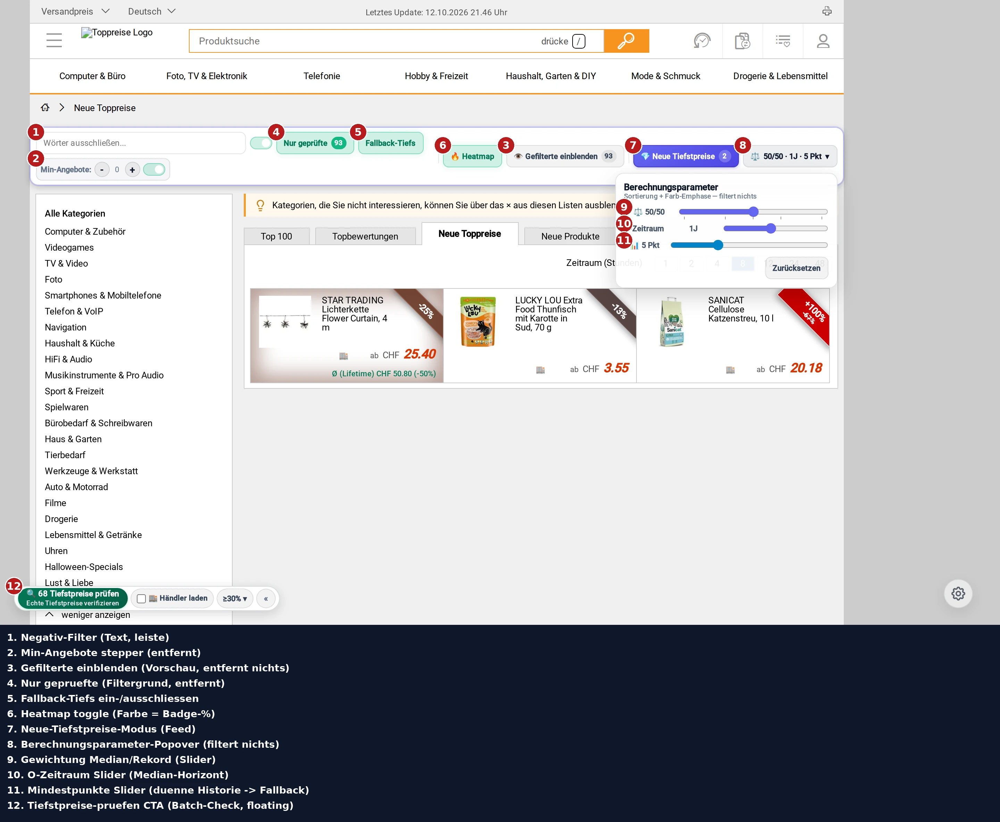
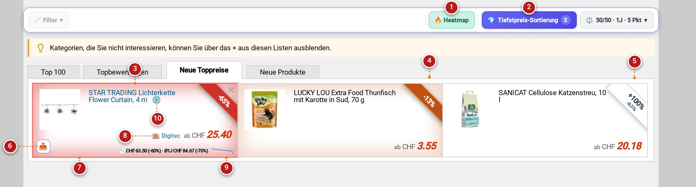
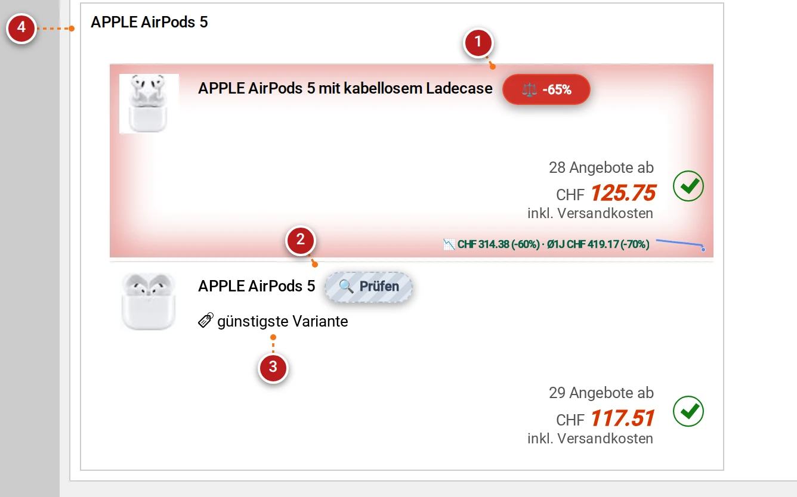
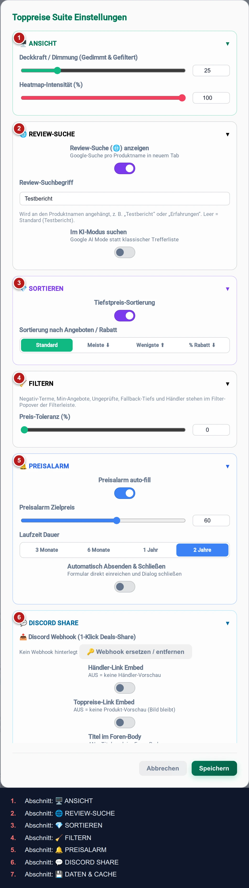

# Toppreise.ch Suite: Power Filter & Price Alarm Auto-Filler

All-in-one userscript for Toppreise.ch that highlights best price offers, verifies authentic all-time Tiefstpreise (Allzeit-Tiefstpreise) vs fake discounts, excludes unwanted negative keywords, sorts/filters by offer count, renders dynamic deal discount heatmaps, and automates price alarm creation. Category blocking is left to Toppreise's native server-side exclusions (`Plugin_IgnoredCategories`: per-card menu, sidebar, top bar).






## 🚀 Installation

Requires Violentmonkey (or a compatible userscript manager):
- [Firefox](https://addons.mozilla.org/en-US/firefox/addon/violentmonkey/)
- [Chrome / Brave](https://chromewebstore.google.com/detail/violentmonkey/jinjaccalgkegednnccohejagnlnfdag)

### 👉 [**CLICK HERE TO INSTALL USERSCRIPT (v2.18.220)**](https://raw.githubusercontent.com/tazztone/userscripts/main/toppreise/toppreise.user.js)

---

## ⚡ Features

1. **💎 Neue Tiefstpreise: Kuratierter Tiefstpreis-Feed mit Gewichteter Differenz & Statistischem Filter**:
   - **1-Klick-Feed-Modus (`[ 💎 Neue Tiefstpreise ]`)**: Verwandelt `/neue-toppreise` per Knopfdruck in einen echten Tiefstpreis-Feed. Filtert Schein-Rabatte und unvollständige Daten automatisch aus und sortiert alle Angebote nach echter Ersparnis.
   - **🔥 Gewichtete-Differenz Ranking & Badge-Heatmap (gekoppelt)**: Für jedes verifizierte Angebot wird die Gewichtete Differenz aus Median-Rabatt ($D_{\text{median}}$) und Allzeit-Rekordmarge ($D_{\text{record}}$) berechnet — **eine Zahl**: Sie steht auf dem Ribbon, färbt Karte + Badge auf einer Grau→Rot-Skala (tiefrot = grosser Tiefstpreis, grau = kein Rabatt) und sortiert den Feed. Niemals der Score und nach Prüfung niemals die Differenz — Aufschläge bleiben grau (`+XX%` steht im Badge). Blasse Farben = ungeprü…
  - **📅 Rollierender Median-Zeithorizont (Slider: 30–730 Tage + Lifetime)**: Verhindert verzerrte Durchschnittspreise bei älteren Produkten (z. B. 2–3 Jahre alte Grafikkarten/Fernseher mit hohem Launch-UVP). In den Einstellungen kann der Vergleichszeitraum für den Marktpreis frei gewählt werden (Standard: 1 Jahr / 365 Tage). Ein Wechsel (Leiste oder Einstellungen) rechnet alle gecachten Mediane sofort lokal neu — Karten aktualisieren sich live ohne erneute Prüfung oder Netzabfrage.
   - **🛡️ Multi-Pass Preisfehler- & Ausreisser-Filter**: Erkennt und ignoriert automatisch kurzzeitige Händler-Fehllistings (z. B. ein CHF 15 Handy-Case, das versehentlich unter einem CHF 1'200 Smartphone gelistet war), sodass echte Allzeit-Tiefstpreise nicht fälschlicherweise blockiert werden.
  - **🏷️ Tiefstpreis Badge & Subline**: Das Kreisbadge trägt die Gewichtete Differenz (`⚖️ -X%`). Die Subline unter dem Preis verankert beide Beine mit CHF und % (`📉 CHF 2'399.00 (-X%) · Ø (1J) CHF 2'450.00 (-Y%)`). Ohne qualifizierte Historie (kein Ø-Vergleich) trägt das Badge stattdessen den Vortief-Abstand (`-X%`) neben `Tiefstpreis` — Fallback-Ribbon, ersatzweise die erhaltene Site-%-Zahl. Der Tooltip meldet nur ignorierte Ausreisser; die Farb-Bedeutung erklärt der Heatmap-Button. Links neben dem Preis steht der günstigste Händler (`🏬 Name`, verlinkt direkt aufs Händlerangebot im neuen Tab, Fallback Produktseite) — direkt aus der Händlerzeile, im Feed per `🏬`-Button einmalig nachladbar (erscheint bei Karten-Hover, nach dem Laden immer sichtbar; oder automatisch: `🏬 Händler laden`-Schalter direkt in der Prüf-Pille bzw. in den Einstellungen unter Daten & Cache, max. 3 parallele Abfragen) und danach per localStorage auch nach Reload sofort da (gleiche TTL wie Preishistorie). `🗑️ Cache leeren` verwirft Preis-/Händler-Cache, `🧨 Alle Daten löschen` setzt zusätzlich alle Einstellungen zurück.
   - **⚖️ Konfigurierbare Sortier-Gewichtung**: Im Einstellungsmenü (oder per `⚖️`-Popover in der Leiste) kann das Mischverhältnis zwischen Alltags-Ersparnis (Median) und Rekord-Tiefstpreis stufenlos angepasst werden (Standard: 50% / 50%) — setzt Reihenfolge + Farb-Emphase, das Badge zeigt stets die daraus folgende Zahl. Ein Rechenbeispiel (`z.B. Rek −10% + Ø −25% → Gewichtete Differenz 18`) läuft live beim Ziehen mit; der Popover-Slider rastet in 5er-Schritten (`100% Med` … `100% Rek`).
   - **Non-Destructive Auto-Scan & Grid-Safe Sorting**: Ungeprüfte Produkte bleiben während des Paced Scans mit dezentem `⏳ Prüfe...`-Spinner sichtbar und sortieren sich live ein, ohne das Bootstrap-Grid zu beschädigen. Beim Deaktivieren wird die ursprüngliche Feed-Reihenfolge 100% sauber wiederhergestellt.
2. **🌟 Integrierte Allzeit-Tiefstpreise & Allzeit-Tiefstpreis Prüfung**: Verifiziert echte Rekord-Preise direkt im bestehenden Toppreise Differenz-Kreisbadge (`.badge-dif`) ohne störende Extra-Badges.
   - **1-Klick-Check im Differenz-Badge (`🔍`)**: Das Rabatt-Kreisbadge besitzt eine dezente Eck-Lupe und löst per Klick direkt die historische Tiefstpreis-Prüfung aus. Daneben steht ein tastaturbedienbarer `🔍`-Button (`Differenz prüfen`) mit derselben Aktion.
   - **`🌟 Allzeit-Tiefstpreis` & Neuer Rekord-Tiefstpreis**: Verifizierte Tiefstpreise tragen die Gewichtete Differenz als Karten- und Badge-Farbe (tiefrot = grosser Tiefstpreis, grau = kein Rabatt). Bei neuen Allzeit-Tiefstpreisen zeigt die Subline zusätzlich den bisherigen Tiefstpreis (`Bisher CHF 1'978.15`). Aufschläge bleiben grau (`Aufschlag +XX%`).
   - **`⚠️ +XX%` Aufschlag-Morph & Gestrichener Schein-Rabatt (`~~-YY%~~`)**: Entlarvt Schein-Rabatte direkt im Kreisbadge mit auffälligem `+XX%` Aufschlag und durchgestrichenem Feed-Rabatt `<s>-YY%</s>`, plus `Tiefstpreis: CHF XX.XX` unter dem Preis.
   - **Konsolidierter Filter (`🧹 Filter (N)`)**: Ein Button zeigt die Gesamtzahl aller verborgenen Produkte (plus `+M gedimmt`); das Popover listet je Ursache (Negativ, Min-Angebote, Händler, Ungeprüfte, Fallback-Tief) Ein-Schalter, Trefferzahl und Verbergen/Dimmen-Modus. (Native Kategorie-Ausschlüsse verwaltet Toppreise serverseitig in seiner eigenen Leiste.)
   - **Batch-Checker mit Live-Zähler (`🔍 Tiefstpreise prüfen (N)`)**: Prüft auf Knopfdruck nacheinander alle Deals ab dem Schwellenwert mit Live-Fortschrittszähler und Abbruch-Option.
   - **Neu-Geprüft-Glow (`Neu`-Puls)**: Frisch verifizierte Tiefstpreise pulsen mind. 5s mit Kontur + `Neu`-Markierung und erlöschen bei der nächsten Interaktion (Klick/Scroll/Taste); bereits früher geprüfte Karten bleiben statisch. Der Abschluss-Toast nennt die Neu-Zahl (`X Tiefstpreise verifiziert · Y neu`).
   - **Differenz-Vorauswahl (`≥30% ▾` im Prüf-CTA)**: Prüf-Vorauswahl für den Batch-Scan (20%, 30%, 40%, 50%, 60%): Nur Differenzen ab diesem Wert (ungeprüfte Differenz, z.B. vs UVP) werden automatisch geprüft — die Prüfung ersetzt sie durch den echten Rabatt.
  - **Selektive, ehrliche Heatmap**: Die Farbe folgt der Gewichteten Differenz auf einer Grau→Rot-Skala, nicht der Differenz (ungeprüft). Verifizierte Aufschläge zeigen `+XX%` (Badge) und bleiben grau; ungeprüfte Karten lesen sich an voller Deckkraft mit grau gestreiftem Badge + 🔍 und heizen nie. Per `Nur geprüfte`-Zeile im Filter-Popover (Filterleiste) lassen sich ungeprüfte Angebote verbergen oder dimmen — der Filter greift nur, wenn die Seite mindestens eine geprüfte Karte hat, und leert nie eine ungeprüfte Seite.
  - **Fallback-Tiefs (Vortief, dünne Historie)**: Verifizierte Tiefstpreise ohne qualifizierte Historie (kein Ø-Vergleich) heizen dezent von außen (äußerer Glow, bei flachen Differenzen gar nicht) statt der prominenten Innen-Wasche verifizierter Deals mit Ø-Vergleich; der Badge-Tooltip weist sie als Fallback aus. Per `Fallback-Tiefs`-Zeile im Filter-Popover (Filterleiste) lassen sie sich ein-/ausschließen — Schalter AN schließt sie aus (Filtergrund: verborgen oder gedimmt, je Modus). Die Schwelle dafür setzt der `📊`-Slider im `⚖️`-Popover (Mindestanzahl Datenpunkte in der Preishistorie, 1–5 fein dann 10er-Schritte bis 100, Punkte ≈ Tage): darunter kein Blend — Karte wird Fallback-Tief.
   - **Detailseiten-Badge (`/preisvergleich/...-p...`)**: Zeigt direkt auf Produktseiten neben dem Haupttitel/Hauptpreis, ob das Angebot ein Allzeit-Tiefstpreis ist.
  - **Leere-Feed-Hinweis (Empty State)**: Blendet bei komplett verborgener Seite einen eleganten Hinweis mit Schnellaktionen ein (`[ ⚡ Filter ausschalten ]`, dazu je nach Lage `[ 🔍 Tiefstpreise prüfen (≥N%) ]` und `[ Alle anzeigen / Nur geprüfte ]`).
   - **Konfigurierbarer Cache & 1-Klick Wipe**: Einmal geprüfte Produkte bleiben im Browser gespeichert (Dauer frei wählbar: 24h, 48h [Standard], 72h, 7 Tage, 14 Tage) und laden bei Folgebesuchen blitzschnell ohne Netzwerkabfrage. Nicht verfügbare Produkte werden zwischengespeichert (1h–24h). Im Einstellungsmenü gibt es eine Live-Anzeige der gespeicherten Einträge und einen `🗑️ Cache leeren`-Button.
3. **🏷️ Inline Tiefstpreis-Pills & Produktvarianten-Schutz auf Kategorieseiten (`/produktsuche/...`)**:
   - **Kompakte 1-Zeilen Inline Tiefstpreis-Pills (`.tp-deal-pill`)**: Auf Kategorieseiten und in Suchergebnissen werden Prüf-Buttons platzsparend als horizontale 1-Zeilen-Pills direkt über dem Preisblock eingebunden (`[ 🔍 Prüfen ]`, `[ 🌟 Tiefstpreis -XX% ]`, `[ ⚠️ +XX% ]`). Keine Überlappungen mehr mit Preisen, Angeboten oder Sparklines.
   - **Vollständiger Schutz für Produktvarianten-Serien (`.Plugin_ProductCollItem`)**: Gruppierte Produktfamilien (wie z. B. Apple AirPods 5 mit/ohne Wireless Case) bleiben als geschlossene Einheit erhalten. Die Sortierlogik zieht Varianten niemals auseinander und zerstört nicht das Bootstrap-Layout.
   - **Kompakte Subcards & Titel-Pills**: In Varianten-Subcards (`.f_collection`) wird die Tiefstpreis-Pill elegant neben dem Variantentitel platziert, während Etiketten wie `🏷️ günstigste Variante` exakt an ihrer nativen Position bleiben.
   - **Verfügbarkeits-Icon Baseline & Randabstand**: Garantiert, dass der grüne Lieferbarkeits-Punkt (`.Plugin_AvailabilityInformation`) vertikal zentriert bleibt und selbst bei langen historischen Preisen und Sparklines niemals am rechten Kartenrand abgeschnitten wird.
   - **Händlerfilter-Kompatibilität**: Verhindert falsches Dimmen von Kategoriemarkt-Karten ohne Händlertabellen, wenn ein spezifischer Händler im Filter ausgewählt ist.
4. **📈 Mini Preis-Trend Sparklines**: Zeigt auf Karten mit geprüfter Preishistorie kompakte Inline-SVG-Sparklines des historischen Preisverlaufs in neutralem Blau (in den Einstellungen aktivierbar). Auf Detailkarten spannt sich der Verlauf als Full-Width-Strip vom Share-Button bis zum Kartenrand, mit Live-Preis-Punkt am rechten Ende. Klick auf die Sparkline öffnet den grossen Preis-Chart mit Achsen (gleiche Darstellung wie das Discord-Chartbild). Lädt blitzschnell in einem einzigen Request ohne zusätzliche Server-Abfragen.
5. **🔥 Continuous Badge-Heatmap (Grau→Rot-Skala)**: Thermische Karten- und Badge-Färbung anhand der angezeigten Badge-%:
   - Grosser Rabatt (z.B. −58%): Tiefes Rubinrot 🔥 (Karte + Badge)
   - Kleiner Rabatt (z.B. −8%): Helles Warmbraun
   - `±5%` und Aufschläge (z.B. +53%): Neutrales Grau ⚖️ (kein Signal; `+XX%` steht im Badge)
  - Ungeprüft (Differenz (ungeprüft)): grau gestreift + 🔍, keine Heat-Farbe (Differenz ≠ Tiefstpreis)
   - 1-Klick-Toggle (`[ 🔥 Heatmap ]`) direkt in der oberen Filterleiste mit stufenloser Intensitätsregelung.
6. **🛡️ Encapsulated Shadow DOM Settings Modal (`#tp-root`)**: Floating action button (FAB) and settings dialog are isolated inside an open Shadow Root, elevated to the browser Top Layer via native `<dialog>` (`showModal()`) to bypass host site z-index and CSS reset collisions.
7. **⌨️ Tastatur-Shortcuts**:
    - `/`: Sofortiger Fokus und Textauswahl im Negativ-Filter (wird bei aktiven Formularfeldern ignoriert).
    - `Escape`: Schließt das Einstellungsmenü bzw. hebt den Filter-Fokus auf.
8. **📥 / 📤 JSON Konfigurations-Import & Export**: Vollständiges Sichern und Wiederherstellen aller Einstellungen (Begriffsfilter, Schwellenwerte) per JSON-Datei mit Whitelist-Validierung.
9. **Händler Toppreis Highlights**: Highlights products with an emerald green border & "Toppreis" badge when a filtered store is the cheapest (or within custom margin %), while dimming/hiding non-cheapest products.
10. **Negativer Textfilter (Ausschluss)**: Exclude products containing specific unwanted keywords (e.g. `SAMSUNG, Hülle, Case, Refurbished, Gebraucht`) with word-boundary precision directly via the text input in the inline top filter bar.
11. **Angebote & Rabatt-Sortierung**: Filter out marketplace items with fewer than $N$ offers, plus optional client-side re-sorting by total offer count or highest discount (`% Rabatt ⬇`).
12. **Preisalarm Auto-Filler**: Automatically configures target price (e.g. 60% of current price) and 2-year duration upon clicking the price alarm bell icon, supporting Swiss currency formatting (`CHF 1'299.–`). The bell shows the mode at a glance (dimmed = off, blue outline = fill-only, blue + ⚡ = auto-submit) with live target values in its tooltip, and the ⚙ next to it jumps straight to the Preisalarm settings. With Auto-Submit enabled (default), it also ticks the terms checkbox and submits the alarm form on your behalf — disable Auto-Submit in the settings if you prefer to review and submit manually.
13. **⚡ Context-Aware Top Filter Bar**: Consolidated toolbar with self-labeled controls (no section captions) that automatically adapts to the page context:
    - **Deal Feeds (`/neue-toppreise`)**: Full suite with `🧹 Filter (N)` button (verborgen N, plus `+M gedimmt`) opening the filter popover — one row per cause (Negativ-Text, Min-Angebote-Stepper mit Schalter, `Nur geprüfte`-Schalter, `Fallback-Tiefs`-Schalter (AN = ausgeschlossen), Händler automatisch mit Inaktiv-Zustand) each with Trefferzahl and Verbergen/Dimmen toggle button, plus `Zurücksetzen`; `🔥 Heatmap` toggle, `💎 Neue Tiefstpreise` mode toggle (strictness lives here: an = nur Tiefstpreise, aus = alles zeigen), and the `⚖️` Berechnungsparameter popover (Gewichtung, `Ø`-Horizont, `📊` Mindestpunkte, `🧹` Ausreißer-Filter mit Glitch-Band (`±%`) und Glitch-Fenster (`h`), mit `Zurücksetzen`, plus Live-Vorschau an einer Demo-Historie mit Glitch-Band, Median und Badge-Vorschau). Ausgeschaltete Filter dimmen ihr Werkzeug grau. Verifying lives in the floating `🔍 N Tiefstpreise prüfen` CTA (bottom-left, with `≥30% ▾` Differenz-Vorauswahl), plus the `⚙️` settings shortcut.
    - **Catalog / Search Listings (`/produktsuche/...`)**: Streamlined toolbar with the same `🧹 Filter (N)` button (Negativ- und Min-Angebote- sowie Händler-Zeilen; `Nur geprüfte` und `Fallback-Tiefs` leben nur im Feed), `🔥 Heatmap` toggle — plus the `⚖️` Berechnungsparameter popover (`⚖️` Gewichtung, `Ø`-Horizont, `📊` Mindestpunkte, `🧹` Ausreißer-Filter mit Glitch-Band/Fenster), since browse heat uses them.
    - **Product Detail Pages (`/preisvergleich/...-p...`)**: Filter bar is cleanly suppressed so single-product pages remain uncluttered.
14. **📤 Discord 1-Klick-Share**: Verifizierte Tiefstpreis-Karten tragen einen `📤`-Button, der den Deal per eigenem Webhook in den Discord Deals-Channel postet — Größenhierarchie: `##`-Titel mit Produktlink, `#`-Preis, `#`-Händlerzeile (verlinkter Händlername + kompakter Angebotszahl `+N`), bisheriger Best- und Ø-Preis mit je eigenem Rabatt-% in je eigener Zeile, Produktlink nur bei aktivem Embed zuletzt, plus Produktbild als erster Attachment-Datei (Thread-Vorschau) und Preisverlauf-Bild als zweiter darunter (Text-Sparkline als Fallback). Das Chart-Bild trägt Preis-/Monatsraster mit Endpunkt-Markierung. Webhook-URL in den Einstellungen (⚙️) hinterlegen — GM-privat gespeichert, nie committet oder exportiert. Forum-/Media-Channel werden erkannt: Pro Share entsteht ein neuer Forenpost mit Deal-Titel. Die Schalter `Händler-Link Embed` und `Toppreise-Link Embed` blenden je Link die automatische Vorschau aus (Standard: AUS, Bild bleibt). Das Nachrichten-Layout ist ein Baukasten in den Einstellungen: Template-String mit Tokens (`{title} {price} {dealer} {offers} {spark} {prevlow} {median} {link}`, je Zeile ein Baustein, Größe via `#`/`##`/`-#`, `·` blendet leere Nachbarn aus, `+{offers}` rendert kompakt `+N`), mit Presets, gerenderter Markdown-Live-Vorschau (entprellt, mit Umbruch) und Validierung. Geteilte Deals behalten einen leuchtenden `📤`-Button (bleibt bis Preisänderung, Cache-Leerung oder TTL-Ablauf); erneutes Teilen bleibt möglich.

---

## 🚀 Automatic Updates (`@updateURL`)

The script includes embedded `@updateURL` and `@downloadURL` metadata headers. Violentmonkey and Tampermonkey will check GitHub automatically in the background and keep your installed userscript updated without requiring manual reinstalls.

---

## ⚙️ Configuration & Persistence

Klicke auf das schwebende **Zahnrad-Symbol** unten rechts auf Toppreise.ch, um das aufgeräumte Einstellungsmenü zu öffnen (konsolidiert in 5 übersichtliche Bereiche auf einer Seite ohne störende Tabs):

1. **🖥️ Anzeige**: Darstellung der Gefilterten (`Highlight`, `Dimmen`, `Verbergen`), Preis-Toleranz (%), Deckkraft, Versandkosten-Vergleich und Sortierreihenfolge (`Meiste ⬇`, `Wenigste ⬆`, `% Rabatt ⬇`).
2. **💎 Tiefstpreise & Deals**: Heatmap an/aus (Farbe = Gewichtete Differenz, Grau→Rot), Intensitäts-Regler (20% – 100%), Sortier-Gewichtung für die Gewichtete Differenz (Sortierung + Farb-Emphase), Mindestanzahl Datenpunkte in der Preishistorie (1–5 fein dann 10er-Schritte bis 100, Standard 5), Analyse-Zeithorizont (Slider 30–730 Tage + Lifetime, Standard 1 Jahr) und Prüf-Vorauswahl (Differenz, ungeprüft) für den Tiefstpreis-Scanner.
3. **🔔 Preisalarm**: Zielpreis-Prozentsatz (Standard: 60%), Laufzeit (3 Monate bis 2 Jahre), Auto-Submit & konfigurierbare Schließverzögerungen.
4. **💬 Discord Share**: Webhook-URL, Layout-Baukasten (Template-Tokens, Presets, Live-Markdown-Vorschau), Händler-/Produkt-Embed-Schalter.
5. **💾 Daten & Cache**: Mini-Preiskurven (Sparklines) an/aus, Händler-Autoload, Cache-Gültigkeit (24h bis 14 Tage), Negativ-Cache (1h bis 24h), Live-Eintragszähler und 1-Klick-Cache-Bereinigung (`🗑️ Cache leeren`) sowie JSON Export / Import aller Einstellungen und Begriffsfilter.

> [!TIP]
> **Schnellzugriff in der Filterleiste:** Der `🧹 Filter (N)`-Button öffnet das Filter-Popover: je Ursache (Negativ-Text mit Schalter, `Nur geprüfte`-Schalter, Mindest-Angebote-Stepper mit Schalter, `Fallback-Tiefs`-Schalter (AN = ausgeschlossen), Händler automatisch mit Inaktiv-Zustand) mit Trefferzahl und Verbergen/Dimmen-Modus, dazu `Zurücksetzen` — alles ohne Öffnen des Einstellungsmenüs. Gewichtung, Horizont, Mindestpunkte, Ausreißer-Filter, Glitch-Band und Glitch-Fenster liegen im `⚖️`-Popover (`Berechnungsparameter`, mit `Zurücksetzen`). Gedimmte Karten (`+M gedimmt`) bleiben sichtbar und scanbar; Darstellung (`Highlight`/`Dimmen`/`Verbergen`) in den Einstellungen.

> [!NOTE]
> All settings and negative terms are saved **permanently** with a 2-layer storage architecture (`GM_setValue` / `GM_getValue` with domain `localStorage` auto-healing backup) that survives userscript reinstalls.

---

## 🏗️ Architecture & Development

The source code is modularized under `src/` (23 modules; `node tools/build.js` concatenates them in load-bearing order):
- `src/domain/`: `price.js` (parsing, cents, time-series, horizons), `deal-score.js` (Tiefstpreis classification, Gewichtete Differenz).
- `src/page/`: `selectors.js` (immutable `SELECTORS` registry), `adapter.js` (DOM/price extraction), `cards.js` (card data, heat ramp), `sort.js` (grid sorting).
- `src/scanner/`: `cache.js` (bounded LRU + TTL + pruning), `scanner.js` (fetch orchestration).
- `src/state/`: `config.js` (2-layer persistence, UI sync), `store.js` (runtime scan state).
- `src/ui/`: `shell.js` (shadow skeleton), `styles.js` (design tokens), `modal.js` (settings dialog), `toolbar.js` (filter bar), `mini-toggle.js` (toggle primitive), `badges.js` (deal badges), `sparkline.js` (SVG sparklines), `floating-cta.js` (batch check CTA), `toast.js` (notifications).
- `src/features/`: `share-discord.js` (webhook sharing), `price-alarm.js` (drop alerts), `product-detail.js` (detail-page badge).
- `src/app.js`: orchestration, observers, DOM lifecycle.

### Build Pipeline & Quality Gates

```bash
# Build the distributable toppreise.user.js artifact from src/
node toppreise/tools/build.js

# Verify bundle integrity and detect drift (CI gate)
node toppreise/tools/build.js --check

# Syntax verification
node --check toppreise/toppreise.user.js
```

### 🧪 Test Execution

```bash
# Fast unit tests (~40ms, zero-browser overhead)
node --test toppreise/tests/unit/*.test.js
# Or via pytest:
venv/bin/pytest toppreise/tests/test_price_logic.py

# Targeted Playwright browser regression test suite (~40s)
venv/bin/pytest toppreise/tests/test_catalog_layout.py
```
