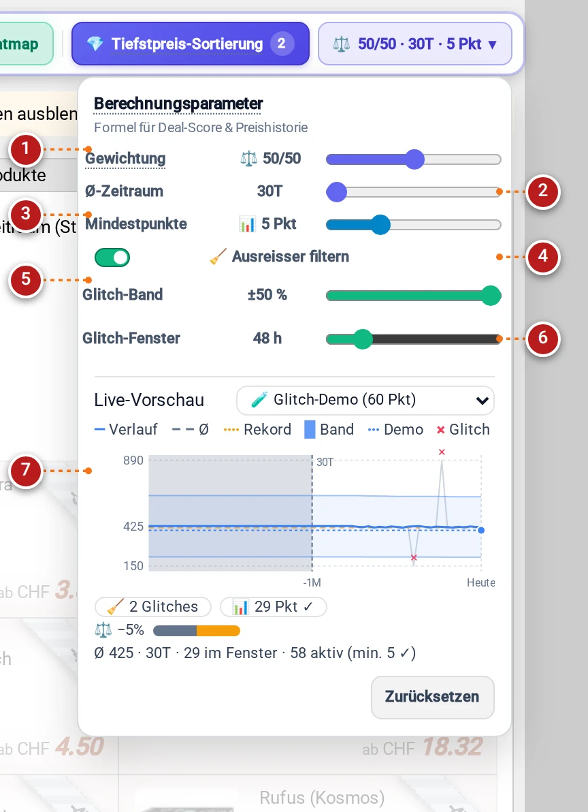
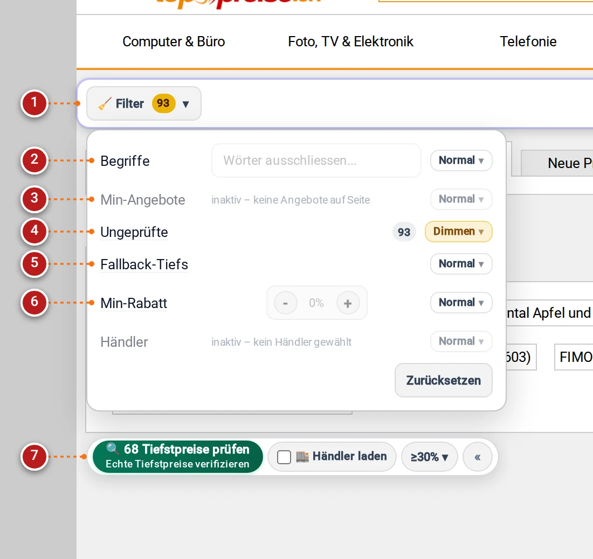
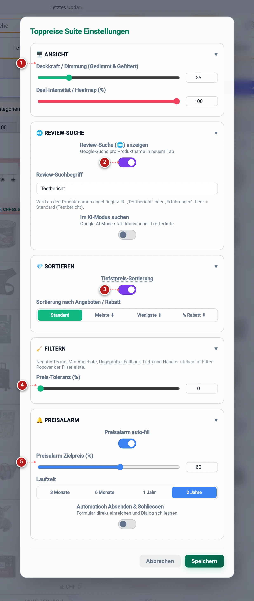
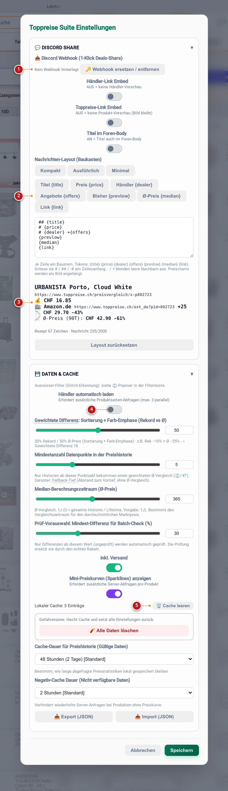

# Toppreise.ch Suite: Power Filter & Price Alarm Auto-Filler

**English Version** · **[🇩🇪 Deutsche Version](README.de.md)**

An all-in-one userscript suite (`v2.18.341`) for **Toppreise.ch** that verifies authentic all-time low prices (*Tiefstpreise*) against complete historical price series, exposes deceptive markups (*Aufschläge*), applies a continuous discount heatmap, provides multi-mode negative/offer/dealer filtering, and automates price alarms and Discord deal sharing. Category blocking is left to Toppreise's native server-side exclusions (`Plugin_IgnoredCategories`: per-card menu, sidebar, top bar).


| # | Signal / Feature | Description |
|---|---|---|
| ① | **Heatmap Toggle** | Switches continuous deal color wash on/off in the sticky toolbar. |
| ② | **Best-Price Sorting** | Sorts listings in-place by authentic weighted deal score (`💎 Tiefstpreis-Sortierung`). |
| ③ | **Single-Hue Deal Heatmap** | Proportional color glow (deep ruby for all-time record lows, warm amber for strong discounts). |
| ④ | **Fallback Low (*Fallback-Tief*)** | Verified low with limited data points (< minPoints): displays breakthrough margin vs. previous record low. |
| ⑤ | **Deceptive Markup Exposure** | Unmasks fake discounts: crosses out unverified site discount and displays true markup (+XX%) above historical low. |
| ⑥ | **1-Click Discord Share** | Hover button to post deal details, interactive chart PNG, and merchant offer directly to your Discord webhook. |
| ⑦ | **Transparent Deal Subline** | Displays previous low margin % and 1-year rolling median with margin %. |
| ⑧ | **Cheapest Dealer (`🏬`)** | Direct link to the cheapest merchant offer without intermediary tracking redirects. |
| ⑨ | **Mini Trend Sparkline** | Compact 30-day price curve; click to expand interactive full-history chart modal. |
| ⑩ | **1-Click Web Search (`🌐`)** | Appears on hover next to product title; opens a Google search for `<Product> <keyword>` in a new tab (keyword configurable, `{preis}` token for current price). |

> [!NOTE]
> **Deal score formula (Card 1, Callout ③):** −65% = 50/50 blend of −60% (vs. previous low) and −70% (vs. 1-year median).

---

## 🎬 Video Demos & Interactive Showcase

[](https://tazztone.github.io/userscripts/)

> 🌐 **Interactive Live Player:** Watch the video demos with instant EN/DE language switching, quick demo loops, and feature walkthroughs on our **[Documentation Site](https://tazztone.github.io/userscripts/)**.

### Direct Video Downloads & Mirrors
| Demo Clip | Duration | Format | Language | Direct Link |
|---|---|---|---|---|
| **Quick Demo** | 1 min | 9:16 Vertical MP4 | 🇬🇧 English | [⬇️ Download `short.mp4`](https://github.com/tazztone/userscripts/releases/download/media-v1/short.mp4) |
| **Kurzübersicht** | 1 min | 9:16 Vertical MP4 | 🇩🇪 Deutsch | [⬇️ Download `short_DE.mp4`](https://github.com/tazztone/userscripts/releases/download/media-v1/short_DE.mp4) |
| **Full Walkthrough** | 7 min | 16:9 HD MP4 | 🇬🇧 English | [⬇️ Download `explainer.mp4`](https://github.com/tazztone/userscripts/releases/download/media-v1/explainer.mp4) |
| **Ausführliche Erklärung** | 7 min | 16:9 HD MP4 | 🇩🇪 Deutsch | [⬇️ Download `explainer_DE.mp4`](https://github.com/tazztone/userscripts/releases/download/media-v1/explainer_DE.mp4) |

---

## 🚀 Quick Install

Requires a userscript manager browser extension:
- [Violentmonkey](https://violentmonkey.github.io/) (recommended: [Firefox](https://addons.mozilla.org/en-US/firefox/addon/violentmonkey/) · [Chrome / Brave](https://chromewebstore.google.com/detail/violentmonkey/jinjaccalgkegednnccohejagnlnfdag))
- [Tampermonkey](https://www.tampermonkey.net/)

### 👉 [**CLICK HERE TO INSTALL USERSCRIPT (v2.18.407)**](https://raw.githubusercontent.com/tazztone/userscripts/main/toppreise/toppreise.user.js)

> [!NOTE]
> The userscript includes embedded `@updateURL` and `@downloadURL` metadata headers. Your userscript manager will automatically check GitHub in the background and keep your installation up to date.

---

## ✨ Key Features

### 🔍 Real Deal Verification & Weighted Deal Score (*Gewichtete Differenz*)



| # | Parameter / Component | Description |
|---|---|---|
| ① | **Deal Weighting Slider** | Balances scoring between breakthrough record margin and rolling median savings. |
| ② | **Average Time Horizon (*Ø-Zeitraum*)** | Configures rolling median window (30 to 730 days or Lifetime) to prevent obsolete launch MSRP bias. |
| ③ | **Minimum Data Points** | Threshold of historical observations required before qualifying for weighted deal scoring. |
| ④ | **Glitch Filter Switch** | Enables automated price-spike rejection using moving median windows. |
| ⑤ | **Glitch Deviation Band** | Configures tolerance threshold (±1%–50%) around the median before a point is treated as an outlier. |
| ⑥ | **Glitch Window Duration** | Sets maximum anomaly duration (24h–168h) for transient indexing glitches. |
| ⑦ | **Live Glitch Preview Chart** | Real-time SVG preview with dynamic X-axis time grid & live cutoff boundary, showing Ø-price, record floor, glitch band, and detected glitches (red ✕ markers). |

* **On-Demand & Batch Verification:** Click any product's Differenz badge (`🔍`) or use the floating **Batch-Check CTA** (bottom-left) to fetch full historical price series for all visible deals meeting your discount threshold (`≥20%–60%`), with a live progress counter and cancel button.
* **Weighted Deal Score (`⚖️`):** Verified all-time lows are scored using a customizable blend between **discount vs. rolling median (`Ø-Preis`)** and **breakthrough margin vs. the previous all-time low (`Rekord`)**. This produces a single metric that drives the badge percentage, card heat color, and feed ranking.
* **Rolling Median Time Horizon (30–730 Days + Lifetime):** Prevents distorted baseline prices on aging tech (e.g. 2-year-old GPUs or TVs with obsolete launch MSRPs). Adjusting the horizon immediately recomputes all cached mediane locally without network requests.
* **Glitch & Outlier Rejection:** Multi-pass filter automatically sanitizes short-lived mislistings (e.g. a CHF 15 smartphone case mistakenly indexed under a CHF 1'200 flagship) using a rolling ±15-point local median window (configurable band `±1%–50%`, max glitch duration `24h–168h`), with an interactive live SVG preview inside the toolbar's `⚖️` popover.
* **Deceptive Discount Detection:** Products priced above their historical low are flagged with an `Aufschlag (+XX%)` badge and a strikethrough of the unverified site discount (`~~-YY%~~`), showing the true historical low below the price.
* **Detailed Deal Subline & Cheapest Dealer (`🏬`):** Cards display the exact price breakdown (`📉 CHF 2'399.00 (-X%) · Ø (1J) CHF 2'450.00 (-Y%)`) along with the cheapest dealer name and direct offer link, with optional background auto-fetching (`max. 3 parallel`).
* **Shipping-Basis Aware (`inkl. Versand`):** Separately caches and evaluates product-only (`_p`) and shipping-inclusive (`_s`) price histories so comparisons never mix price bases.

### 🔥 Visual Signals, Sparklines & Card Enhancements

* **Single-Hue Deal Heatmap (Grau→Rot):** Verified deals glow with a customizable inset color ramp proportional to deal depth (neutral gray for small or zero discounts → warm amber → deep ruby for major discounts). Unverified cards show a striped-gray badge with provisional card warmth.
* **Fallback Lows (*Fallback-Tiefs*):** Verified lows lacking a qualified median (insufficient data points `< minPoints`, HTML scrape without time series, or flat history `< 2%`). Display the Vortief-Abstand instead of a blend (no `⚖️`) and can be filtered independently (Normal/Dim/Hide). Qualified deals with 0% savings display a neutral-gray 0% badge.
* **Newly Verified Glow (*Neu*-Puls):** Freshly verified deals pulse with an emerald outline and `Neu` indicator for ≥5s until the next user interaction (click, scroll, keypress).
* **Interactive SVG Sparklines:** Renders a compact mini price-trend chart on verified product cards. Clicking the sparkline opens a full-resolution modal chart with price and date axes.
* **1-Click Web Search (`🌐`):** Appends a quick-search icon on hover to product titles that opens a Google search for `<Product> <keyword>` in a new tab. Keyword is configurable (e.g. `Testbericht`, `Erfahrungen`) and may contain the `{preis}` token (current card price, CHF, verified history only), with optional **Google AI Mode (`&udm=50`)**.

### 🧹 Sticky Filter Bar



| # | Control | Description |
|---|---|---|
| ① | **Filter Button & Global Toggle** | Opens multi-mode filter controls; button displays color-coded state pills (amber for hidden, yellow for dimmed, green for highlighted). Directly beside it, a compact mini-switch temporarily bypasses all active card filters without clearing configured thresholds. |
| ② | **Negative Keywords (*Begriffe*)** | Instant exclusion by keywords with live word-boundary matching. |
| ③ | **Minimum Offers** | Filters out marketplace offers with fewer than **N** merchants (active only on pages with dealer rows). |
| ④ | **Unverified Offers (*Ungeprüfte*)** | Dim or hide deals lacking verified historical price series. |
| ⑤ | **Fallback Lows Toggle** | Filter or dim verified offers with sparse history. |
| ⑥ | **Minimum Discount (*Min-Rabatt*)** | Filter out verified deals with less than **X%** discount (unverified deals remain visible). |
| ⑦ | **Batch Verification CTA** | One-click batch scanner (`🔍 Tiefstpreise prüfen`) to verify all visible offers meeting discount criteria. |

* **Context-Aware Toolbar:** Automatically adapts to deal feeds (`/neue-toppreise`), search listings (`/produktsuche/...`), and detail pages without UI clutter.
* **4-State Per-Cause Filtering:** Every filter rule can be independently cycled between **Normal**, **Dimmen** (adjustable opacity), **Verbergen** (hide), and **Hervorheben** (highlight outline):
  * **Negative Keywords:** Exclude unwanted terms (comma/semicolon/newline lists; long terms `>3` chars match as substrings, short terms `≤3` chars enforce word boundaries).
  * **Minimum Offer Count:** Filter out marketplace listings with fewer than **N** merchants (shows inactive notice on pages without offer counts).
  * **Price Range (*Preis CHF*):** Filter out listings outside your budget using Min and Max price bounds (applies universally to all offers).
  * **Minimum Discount (*Min-Rabatt*):** Filter out verified offers below a minimum deal discount percentage (stepped 0%–50% in 5% increments; unverified offers remain visible).
  * **Absolute Savings (*Ersparnis CHF*):** Filter out verified offers saving less than Min CHF or outside bounds (unverified offers remain visible).
  * **Unverified (*Ungeprüfte*):** Dim or hide unverified offers across all pages.
  * **Fallback Lows (*Fallback-Tiefs*):** Control visibility of low-history verified offers across all pages.
  * **Selected Dealer Best-Price Check:** Highlights cards with an emerald border and `Toppreis` badge when your active dealer filter holds the cheapest offer (within a configurable `0%–50%` price tolerance margin).
* **Live Grid Sorting:** Sort listings in-place by **Weighted Deal Score (`Tiefstpreis-Sortierung`)** (verified deals and fallback lows by badge % > unverified/unavailable > markups), **% Discount (`% Rabatt ⬇`)**, or **Offer Count (`Meiste ⬇` / `Wenigste ⬆`)**, with clean restoration to natural DOM order when disabled.
* **Empty State Recovery:** If all products are hidden by active filters, an interactive prompt provides instant one-click recovery buttons (`[ ⚡ Filter ausschalten ]`, `[ 🔍 Tiefstpreise prüfen ]`, or `[ Ungeprüfte einblenden ]`).

### 🌳 Expandable Category Sidebar & Instant Search

* **In-Sidebar Navigation:** Expands the native left deal sidebar with accordion toggles (`▸` / `▾`) across all 4 category levels using Toppreise's native category cache (`c_cm_data_de`).
* **Direct Feed Links:** Clicking any subcategory navigates to its dedicated deal feed URL (`/neue-toppreise/...`).
* **Instant Category Search:** Real-time search box above the sidebar filters across all 2,500+ categories with parent path breadcrumbs, direct feed links, and 1-click `✕` exclusion / `+` restore buttons.
* **Native Category Blacklisting (`✕` / `+`):** Preserves and hydrates Toppreise's native server-side category exclusion icons on hover/render across both sidebar branches and search dropdown results.
* **Persistent State:** Expanded sidebar branches are saved in `localStorage` across page reloads.

### 🔔 Price Alarm Auto-Filler

* **Instant Prefill:** Clicking Toppreise's price alarm bell automatically populates target price (`5%–99%`, default `60%`) and duration (`3`, `6`, `12`, or `24` months), with full support for Swiss currency formats (`CHF 1'299.–`).
* **Modes:** Supports **Fill-only** (default: inspect and submit manually) and **Auto-Submit** (ticks terms and submits on click, closing the dialog only after server confirmation).

### 💬 1-Click Discord Deal Sharing (`📤`)

* **Interactive Preview & Multi-Channel Support:** Verified all-time low cards display a `📤` button on hover. Clicking opens a real-time preview modal with rendered Markdown and chart/product images, featuring individual action buttons for each configured channel (e.g., `#deals`, `#gaming`).
* **Multiple Webhook Channels:** Configure and name multiple Discord webhooks in settings (confidential, stored locally in `GM_setValue`, never committed or exported).
* **High-DPI Chart & Product Image Upload:** Rasterizes the price history chart to PNG and attaches it alongside the product image (used as thread preview in Discord forum channels).
* **Customizable Template Engine (*Baukasten*):** Tailor your Discord message layout with tokens (`{title}`, `{price}`, `{dealer}`, `{offers}`, `{prevlow}`, `{median}`, `{ai}`, `{link}`), layout presets (*Kompakt*, *Ausführlich*, *Minimal*), live Markdown preview, and independent link embed suppression toggles.

---

## 🧭 Quick-Reference Usage Guide

| Control / Icon | Location | Action |
| --- | --- | --- |
| **Sticky Filter Bar** | Top of product listings | Filter by negative keywords, minimum offers, and per-cause modes; toggle Heatmap and Tiefstpreis-Sortierung; open the `⚖️` calculation popover. |
| **Category Sidebar (`▸`/`▾`)** | Left sidebar on deal feeds | Expand/collapse subcategories, search across 2,500+ categories, or navigate to sub-feeds. |
| **Floating Check CTA** | Bottom-left floating pill | One-click batch verification of all visible deals meeting the discount threshold (`≥X%`), with an inline `🏬` dealer auto-fetch toggle. |
| **Differenz Badge (`🔍` / `⚖️`)** | Top-right of product card | Click to verify or refresh a single product's price history and all-time low status. |
| **Cheapest Dealer (`🏬`)** | Next to price on verified card | Click to jump directly to the merchant offer in a new tab; hover to load dealer on feed cards. |
| **Mini Sparkline** | Bottom of verified card | Click to open the large interactive price history chart modal. |
| **Share Button (`📤`)** | Bottom-left of verified card | Opens preview modal with message and chart PNG, posting to your chosen Discord channel webhook. |
| **Web Search & AI Verdict (`🌐`)** | Next to product title | Opens AI review verdict modal (with Tavily key) or Google search in a new tab. |
| **Settings FAB (`⚙️`)** | Bottom-right floating button | Opens the encapsulated Shadow DOM settings modal. |

### ⌨️ Keyboard Shortcuts

| Shortcut | Context | Action |
| --- | --- | --- |
| `/` | Anywhere on listing page | Instantly focuses and selects text in the Negative Keyword filter input (ignored during active text input). |
| `Escape` | Modal or active filter | Closes the Settings modal or removes focus from the filter input. |

---

## 📑 Page Contexts & Variant Protection

The userscript dynamically tailors its UI to the current page type:


| # | Feature | Description |
|---|---|---|
| ① | **Verified Deal Pill** | Compact inline pill next to product title showing true weighted discount. |
| ② | **Unverified Scan Pill** | Striped-gray badge indicating unverified catalog item; click to fetch price history. |

* **Deal Feeds (`/neue-toppreise`):** Displays the full suite: consolidated filter button (`🧹 Filter (N)`), continuous heatmap toggle, `💎 Tiefstpreis-Sortierung`, floating batch scanner, and calculation popover (`⚖️`).
* **Catalog & Search Listings (`/produktsuche/...`):** Streamlined toolbar with complete protection for grouped product families (`.Plugin_ProductCollItem`). Grouped variants (such as AirPods with or without wireless charging case) remain locked in their native collection containers, preserving Bootstrap grid integrity without splitting cards. Inline deal pills (`.tp-deal-pill`) sit neatly next to product titles.
* **Product Detail Pages (`/preisvergleich/...-p...`):** Hides the top filter bar and embeds a dedicated Tiefstpreis badge next to the main product title and price.

---

## ⚙️ Configuration & Modal Settings

Click the floating **gear icon (`⚙️`)** in the bottom-right corner to open the Shadow DOM settings dialog (`#tp-root`). Elevated via native HTML5 `<dialog>` (`showModal()`) to the browser Top Layer, it avoids z-index collisions with host site elements. Split into Core and Advanced views for legibility:

### Core Settings (Sections 1–5: Display, Web Search, Sorting, Filtering, Price Alarm)



| # | Setting / Action | Description |
|---|---|---|
| ① | **Dimmer Opacity Slider** | Adjusts background opacity of filtered and dimmed listings. |
| ② | **Web Search (🌐)** | Configures Google Web quick search (keyword presets, `{preis}` token) with optional AI overview mode (`&udm=50`). |
| ③ | **Best-Price Sorting** | Enables ranking by weighted deal quality score (`💎 Tiefstpreis-Sortierung`). |
| ④ | **Price Tolerance Margin (%)** | Sets allowable premium over best price when evaluating preferred merchant deals. |
| ⑤ | **Price Alarm Auto-Fill** | Pre-fills target price percentage (5%–99%) and duration (3–24 months). |

### Advanced Settings (Sections 6–7: Discord Share & Data/Cache)



| # | Setting / Action | Description |
|---|---|---|
| ① | **Discord Channels & Webhooks** | Configures confidential webhook URLs for multiple named Discord channels (never committed or exported). |
| ② | **Discord Layout Chips** | Variable token builder (`{title}`, `{price}`, `{dealer}`, `{prevlow}`, `{median}`, `{link}`). |
| ③ | **Live Markdown Preview** | Instant preview of the rendered Discord embed and message structure. |
| ④ | **Dealer Background Autoload** | Fetches cheapest merchant information automatically for deals meeting threshold (max. 3 parallel). |
| ⑤ | **Local Data & Cache Management** | Cache purge (`🗑️`), full reset (`🧨`), TTL adjustments, and configuration export. |

1. **🖥️ Display (*Ansicht*):** Dimmer opacity for filtered cards, hide ad placeholders / banners (removes top blank space and layout ad slots), and deal intensity / heatmap strength (20%–100%).
2. **🌐 Web Search & AI Verdict (*Web-Suche*):** Search toggle (`🌐`) on product titles, custom keyword with `{preis}` placeholder, inline default reset, live query preview, Google AI mode (`&udm=50`), and Tavily AI toggle (defaults to off) with API key for 1-click in-page AI test verdicts and `{ai}` Discord sharing (48h cached).
3. **💎 Sorting (*Sortieren*):** Authentic deal scoring sort (`💎 Tiefstpreis-Sortierung`) and secondary offer/discount sorting (`Standard`, `Meiste ⬇`, `Wenigste ⬆`, `% Rabatt ⬇`).
4. **🧹 Filtering (*Filtern*):** Preferred dealer price tolerance margin (%); note directing to filter bar popover for negative keywords, min offers, unverified, and fallback lows.
5. **🔔 Price Alarm (*Preisalarm*):** Target price percentage (5%–99%, default 60%), alarm duration (3, 6, 12, 24 months), and Auto-Submit toggle.
6. **💬 Discord Share:** Confidential webhook channels (`GM_setValue` only), link embed suppression, layout token builder (`{title}`, `{price}`, `{ai}`, etc.), presets, and live Markdown preview.
7. **💾 Data & Cache (*Daten & Cache*):** Dealer background autoload, weighted deal blend slider (record vs. median), minimum history data points, rolling median horizon, batch check discount threshold, shipping basis (`inkl. Versand`), sparklines, configurable RAM & disk cache limits, cache TTL, cache purge (`🗑️`), full reset (`🧨`), and JSON configuration export/import.

---

## 🔒 Privacy, Storage & Permissions

* **Local-First Caching:** Price series (`tp_hist_v1_*`), merchant metadata (`tp_dealer_v1_*`), and shared-deal markers (`tp_shared_v1_*`) are stored in `localStorage` backed by an in-memory LRU cache with configurable limits (default: 500 RAM / 300 disk items) and automatically pruned by TTL (48h for valid data, 2h for unavailable charts).
* **Two-Layer Persistence:** Preferences and negative filters use a resilient 2-layer storage architecture (`GM_setValue` / `GM_getValue` with domain `localStorage` auto-healing backup) that survives userscript reinstalls.
* **Secrets Confidentiality:** Your `DISCORD_WEBHOOK_URL` and `TAVILY_API_KEY` are saved exclusively in private userscript manager storage (`GM_setValue`). They are **never** mirrored to page-accessible `localStorage` and are automatically stripped from JSON configuration exports.
* **Granted Permissions:**
  * `GM_getValue` / `GM_setValue` / `GM_deleteValue`: Isolated persistent configuration storage.
  * `GM_xmlhttpRequest` (`@connect toppreise.ch`, `@connect discord.com`, `@connect api.tavily.com`): Used to fetch product images for Discord attachments, dispatch deal payloads to Discord webhooks, and request Tavily search summaries.

---

## 🛠️ Architecture & Development

The source code is modularized into 45 ESM modules under `src/` (each `<25 KB`), bundled in strict load-bearing order by `tools/build.js`:

```text
src/
├── domain/       # Pure price parsing, outlier sanitization, median & deal scoring math
├── scanner/      # Bounded LRU/localStorage cache & rate-limit-aware batch scanner
├── page/         # DOM selectors, page adapter, card/offer extraction & flex grid sorting
├── state/        # Config schema, migrations, GM/localStorage sync & runtime scan store
├── ui/           # Styles, Shadow DOM shell, settings modal, toolbar, badges & SVG sparklines
├── features/     # Discord webhook/recipe engine, price alarm auto-filler & detail page logic
└── app.js        # Pipeline entry point, mutation observers, lifecycle orchestration
```

### Build Pipeline & Quality Gates

```bash
# Compile modular sources from src/ into toppreise.user.js
node toppreise/tools/build.js

# Verify bundle integrity and detect drift (CI gate)
node toppreise/tools/build.js --check

# Check module size boundaries (25 KB advisory)
node toppreise/tools/check-modules.js

# Verify JavaScript syntax of the generated bundle
node --check toppreise/toppreise.user.js
```

### 🧪 Test Execution

```bash
# Fast unit tests (~40ms, zero-browser overhead)
node --test toppreise/tests/unit/*.test.js

# Targeted domain logic tests via pytest
venv/bin/pytest toppreise/tests/test_price_logic.py

# Playwright browser regression test suite (~40s)
venv/bin/pytest toppreise/tests/test_catalog_layout.py
```
